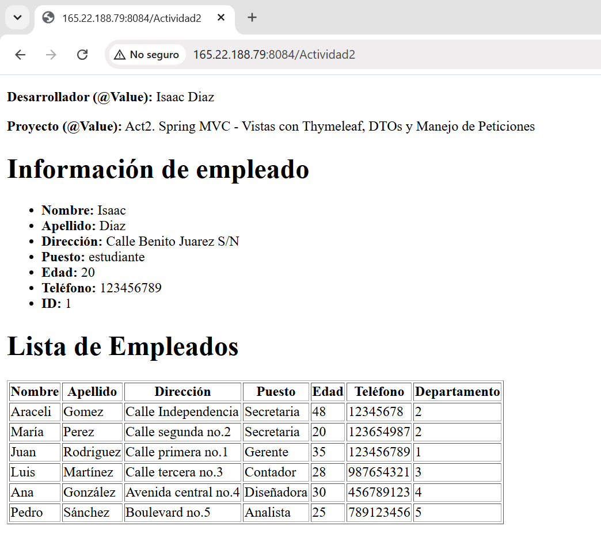
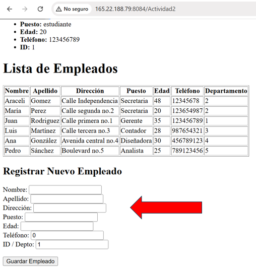
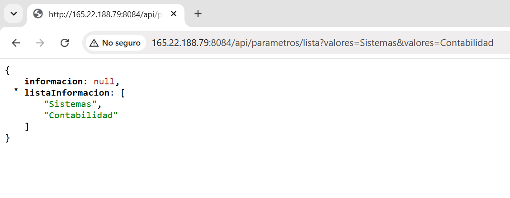
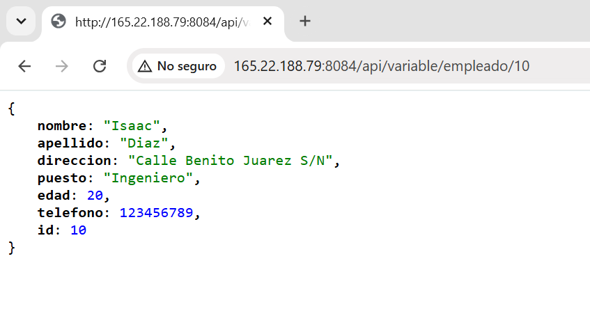
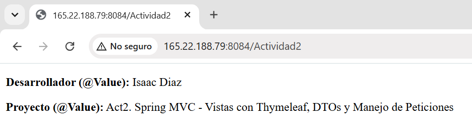
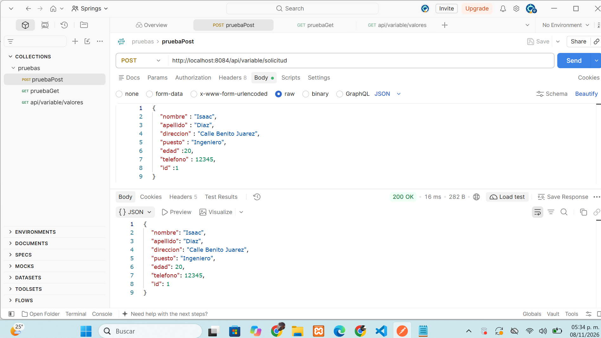

# Actividad 2: Spring MVC - Vistas con Thymeleaf, DTOs y Manejo de Peticiones

**Alumno / Iniciales:** DMIE  
**Repositorio:** DMIEact2_t4  
**Servidor VPS:** `http://165.22.188.79:8084/Actividad2`

## Descripción del Proyecto
Para esta Actividad 2, implementé una estructura híbrida que combina controladores MVC (para renderizar vistas HTML dinámicas) y controladores REST (para responder con JSON). 
Ademas el uso de Thymeleaf con `th:each`, manejo de formularios mediante `@ModelAttribute`, lectura de propiedades desde el archivo `application.properties` usando `@Value`, y endpoints REST para filtrar y buscar información con `@RequestParam` y `@PathVariable`, además de procesar peticiones HTTP POST con objetos DTO.

### 1. Renderizado de Vistas Dinámicas (Thymeleaf)
Demostración de la vista HTML procesando iteraciones con `th:each` e inyección de datos.

### 2. Procesamiento de Formularios (`@ModelAttribute`)
Recepción y envío de datos mediante objeto modelo.

### 3. Filtro por Parámetros (`@RequestParam`)
Endpoint REST procesando listas dinámicas desde la URL (`?valores=Sistemas&valores=Contabilidad`).

### 4. Búsqueda por Parámetros de Ruta (`@PathVariable`)
Consulta REST de detalles dinámicos por ID (`/api/variable/empleado/10`).

### 5. Inyección de Propiedades (`@Value`)
Lectura e inyección de datos desde `application.properties` renderizados en la vista HTML.

### 6. Petición POST con DTO (Postman)
Prueba del servicio REST recibiendo JSON con respuesta exitosa HTTP 200 OK.
